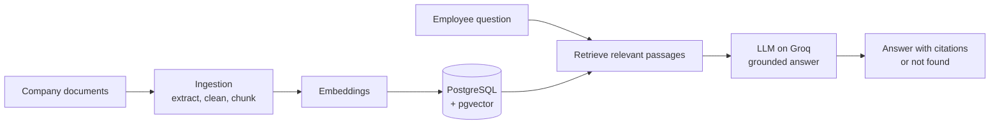

<p align="center">
  
</p>

<h1 align="center">Mboko Media Group</h1>

<p align="center"><strong>Our stories. Our world.</strong></p>

<p align="center">
  Documentaries · Interviews · Digital series · Editorial · Branded campaigns<br>
  Douala, Cameroon
</p>

> **Fictional company.** Mboko Media Group is not a real business. It was created as a realistic, fully documented company to power the [Mboko Knowledge Assistant](#about-this-repository), an internal AI assistant built with retrieval-augmented generation (RAG). Every policy, person and production here is invented.

## Who we are

Mboko Media Group is a Cameroonian media and creative production company based in Douala. We create stories that reflect African people, culture, business, creativity and everyday life, and we share them with audiences in Cameroon and across Africa.

We work in both French and English, the way Cameroon does. A story might start in a Bonabéri workshop, a Yaoundé start-up or a village festival in the West Region, and end up on screens across the continent.

<p align="center">
  
  
</p>

## Mission

**Tell authentic African stories through thoughtful, engaging and responsible media.**

We believe the people closest to a story should shape how it is told. Our job is to listen carefully, report accurately and give those stories the craft they deserve.

## Our values

| Value | What it means at Mboko |
|---|---|
| **Authenticity** | We tell stories from the inside, with the people who live them, never about them from a distance. |
| **Accuracy** | Every fact is checked, every source is respected, and every mistake is corrected openly. |
| **Respect** | We protect the dignity of the people in our stories, especially when they are vulnerable. |
| **Community** | Our audience is a community, not a market. We create with them, not only for them. |
| **Craft** | Good intentions are not enough. We hold our sound, image and writing to a high standard. |

## What we make

<p align="center">
  
  
  
</p>

| Format | Description |
|---|---|
| **Documentaries** | Long-form films on culture, history, enterprise and social change |
| **Interviews** | Conversations with artists, founders, leaders and everyday people with something to say |
| **Digital video series** | Short, regular episodes made for social platforms and mobile viewing |
| **Editorial features** | Researched articles, profiles and lifestyle pieces |
| **Branded campaigns** | Story-led campaigns for organisations that share our values |

### Flagship productions

- **Mboa Makers**: a weekly series on young Cameroonian creators, from fashion designers to app developers
- **Rues de Douala**: a street-level documentary series on the people who keep the city moving
- **Market Voices**: interviews with traders and entrepreneurs in Central African markets
- **Racines**: a documentary series on heritage, music and tradition across Cameroon's regions

## How we are organised

Mboko has six departments. Each one owns its own policies and procedures, which together make up the company knowledge base.

| Department | What it does | Key documents |
|---|---|---|
| 🎬 **Production** | Plans and produces documentaries, interviews and video series | Production schedules, filming procedures, equipment policy, shoot checklists, publishing handover |
| 📰 **Editorial** | Researches, writes and verifies stories, and protects editorial standards | Editorial guidelines, fact-checking policy, corrections procedure, approval requirements, writing standards |
| 🎨 **Creative and Design** | Builds visual identities, graphics, campaign concepts and creative assets | Brand guidelines, design standards, asset requirements, creative review procedure |
| 🤝 **Partnerships and Marketing** | Manages clients, sponsorships, advertising and distribution partners | Partnership policy, sponsorship packages, client onboarding, campaign approval rules |
| 👥 **People and Administration** | Handles recruitment, onboarding, leave, workplace policy and staff records | Employee handbook, leave policy, code of conduct, onboarding guide, workplace procedures |
| 💼 **Finance and Operations** | Oversees budgets, reimbursements, purchasing, travel and planning | Expense policy, reimbursement rules, purchasing procedure, travel policy, budget approvals |

<p align="center">
  
</p>

## About this repository

This repository is Mboko's **internal knowledge base**: the policies, handbooks and procedures that every employee relies on. It is also the data source for the **Mboko Knowledge Assistant**, an AI assistant that answers employees' questions from these documents and cites its sources.

Employees will be able to ask questions like:

- *Who must approve a video before it is published?*
- *How many days of annual leave do I get?*
- *How do I claim back travel expenses?*
- *Can we use a client's logo in our own promotional material?*
- *What do I need to complete in my first week?*

When the documents do not answer a question, the assistant says so instead of inventing a policy.

### How the assistant works



**Stack:** Python, FastAPI, PostgreSQL with pgvector, Groq, pytest and Docker

### Repository structure

```
mboko-media-group/
├── documents/
│   ├── production/
│   ├── editorial/
│   ├── creative-and-design/
│   ├── partnerships-and-marketing/
│   ├── people-and-administration/
│   └── finance-and-operations/
├── images/
└── README.md
```

## Roadmap

- [ ] **Phase 1:** Company knowledge base, with realistic and consistent policies for all six departments
- [ ] **Phase 2:** Project foundation: FastAPI app, configuration and database services
- [ ] **Phase 3:** Document ingestion: loading, cleaning, chunking and source metadata
- [ ] **Phase 4:** Embeddings, vector storage and retrieval
- [ ] **Phase 5:** Grounded answers with citations and "not found" responses
- [ ] **Phase 6:** Evaluation of retrieval, answer accuracy, citations and unanswerable questions
- [ ] **Phase 7:** Tests, Docker, logging and a full demo

<p align="center">
  
</p>

<p align="center">
  <em>Our stories. Our world.</em><br>
  Built by <a href="https://github.com/AshleyMekolle">Mekolle Ashley</a>
</p>

<sub>Image credits: Pexel & Unsplash</sub>
