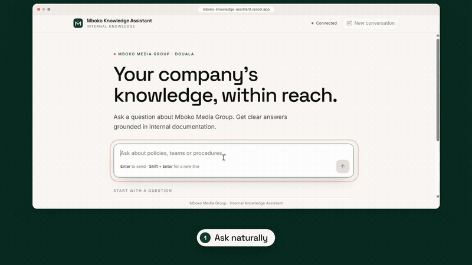
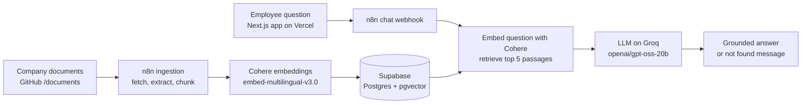
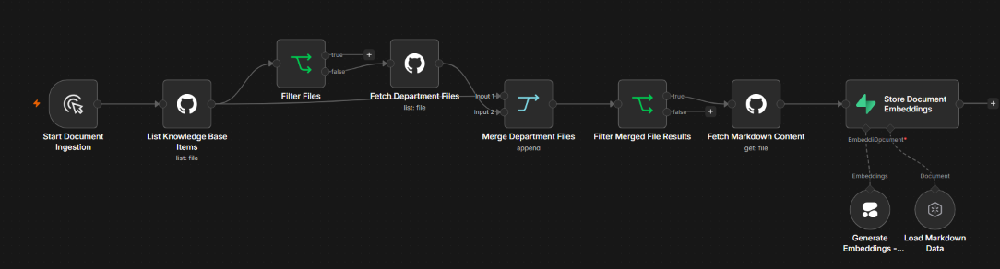
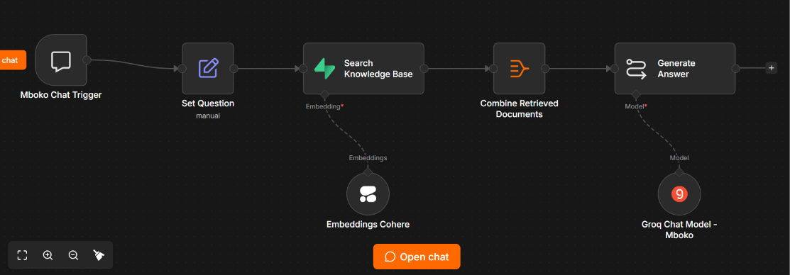

# Mboko Media Group

**Our stories. Our world.**


Documentaries · Interviews · Digital series · Editorial · Branded campaigns | Douala, Cameroon

> **Fictional company.** Mboko Media Group is not a real business. It was created as a realistic, fully documented company to power the [Mboko Knowledge Assistant](#about-this-repository), an internal AI assistant built with retrieval-augmented generation (RAG). Every policy, person and production here is invented.

## Who we are

Mboko Media Group is a Cameroonian media and creative production company based in Douala. We create stories that reflect African people, culture, business, creativity and everyday life, and we share them with audiences in Cameroon and across Africa.

We work in both French and English, the way Cameroon does. A story might start in a Bonabéri workshop, a Yaoundé start-up or a village festival in the West Region, and end up on screens across the continent.

| | |
|---|---|
|  |  |

## Mission

**Tell authentic African stories through thoughtful, engaging and responsible media.**

We believe the people closest to a story should shape how it is told. Our job is to listen carefully, report accurately and give those stories the craft they deserve.

## Our values

| Value | What it means at Mboko |
|---|---|
| **Authenticity** | We tell stories from the inside, with the people who live them, never about them from a distance. |
| **Accuracy** | Every fact is checked, every source is respected, and every mistake is corrected openly. |
| **Respect** | We protect the dignity of the people in our stories, especially when they are vulnerable. |
| **Community** | Our audience is a community, not a market. We create with them, not only for them. |
| **Craft** | Good intentions are not enough. We hold our sound, image and writing to a high standard. |

## What we make

| | | |
|---|---|---|
|  |  |  |

| Format | Description |
|---|---|
| **Documentaries** | Long-form films on culture, history, enterprise and social change |
| **Interviews** | Conversations with artists, founders, leaders and everyday people with something to say |
| **Digital video series** | Short, regular episodes made for social platforms and mobile viewing |
| **Editorial features** | Researched articles, profiles and lifestyle pieces |
| **Branded campaigns** | Story-led campaigns for organisations that share our values |

### Flagship productions

- **Mboa Makers**: a weekly series on young Cameroonian creators, from fashion designers to app developers
- **Rues de Douala**: a street-level documentary series on the people who keep the city moving
- **Market Voices**: interviews with traders and entrepreneurs in Central African markets
- **Racines**: a documentary series on heritage, music and tradition across Cameroon's regions

## How we are organised

Mboko has six departments. Each one owns its own policies and procedures, which together make up the company knowledge base.

| Department | What it does | Key documents |
|---|---|---|
| 🎬 **Production** | Plans and produces documentaries, interviews and video series | Production schedules, filming procedures, equipment policy, shoot checklists, publishing handover |
| 📰 **Editorial** | Researches, writes and verifies stories, and protects editorial standards | Editorial guidelines, fact-checking policy, corrections procedure, approval requirements, writing standards |
| 🎨 **Creative and Design** | Builds visual identities, graphics, campaign concepts and creative assets | Brand guidelines, design standards, asset requirements, creative review procedure |
| 🤝 **Partnerships and Marketing** | Manages clients, sponsorships, advertising and distribution partners | Partnership policy, sponsorship packages, client onboarding, campaign approval rules |
| 👥 **People and Administration** | Handles recruitment, onboarding, leave, workplace policy and staff records | Employee handbook, leave policy, code of conduct, onboarding guide, workplace procedures |
| 💼 **Finance and Operations** | Oversees budgets, reimbursements, purchasing, travel and planning | Expense policy, reimbursement rules, purchasing procedure, travel policy, budget approvals |


## About this repository

This repository is Mboko's **internal knowledge base**: the policies, handbooks and procedures that every employee relies on. It is also the data source for the **Mboko Knowledge Assistant**, an AI assistant that answers employees' questions using only these documents.

**Live assistant:** [mboko-knowledge-assistant.vercel.app](https://mboko-knowledge-assistant.vercel.app)

**Project Demo (55 seconds)**


[](motion-video/mboko-knowledge-assistant-showcase.mp4)

[▶ Watch the full demo video](motion-video/mboko-knowledge-assistant-showcase.mp4)

Employees can ask questions like:

- *Who must approve a video before it is published?*
- *How many days of annual leave do I get?*
- *How do I claim back travel expenses?*
- *Can we use a client's logo in our own promotional material?*
- *What do I need to complete in my first week?*

When the retrieved documents do not answer a question, the assistant replies: *"I couldn't find that information in the Mboko knowledge base."* It does not invent a policy.

> **Hosting notice.** The assistant's backend workflows currently run on an **n8n Cloud trial**. When the trial ends, the website will still load but will not be able to answer questions until the workflows are migrated. See [Hosting and the n8n Cloud trial](#hosting-and-the-n8n-cloud-trial).

### The knowledge base

The knowledge base contains **20 interconnected documents** across the six departments, all sharing one set of fictional people, project codes, approval limits and dates. Browse it from the [knowledge base index](documents/README.md).

| Folder | Documents |
|---|---|
| Company-wide | Index, company profile and glossary, organization directory, approval authority matrix |
| Production | Planning, scheduling and project register; equipment checkout; footage storage and handover |
| Editorial | Standards and fact-checking; interview consent; review, bilingual publishing and corrections |
| Creative and Design | Brand identity and design approval; asset naming, storage and licensing |
| Partnerships and Marketing | Sponsorship and campaign workflow; social media publishing |
| People and Administration | Employee handbook; leave and attendance; recruitment, onboarding and offboarding |
| Finance and Operations | Expense claims and petty cash; procurement, vendors and invoices; budget planning and control |

An [evaluation set of 47 questions](tests/knowledge_base/evaluation_questions.json) is included for testing the assistant. Each question has an expected answer and the IDs of the documents that should support it (for example `COM-POL-001`, `FIN-POL-001`).

| Category | Questions |
|---|---|
| Policy and procedure | 12 |
| Direct fact | 10 |
| Multi-document | 7 |
| Register record | 6 |
| Approval threshold | 3 |
| Unanswerable (documents do not contain the answer) | 9 |
| **Total** | **47** |

The evaluation has **not yet been run** against the live assistant, and no results are published. See [Roadmap](#roadmap).

### Project status

| Capability | Status |
|---|---|
| 20-document knowledge base and 47-question evaluation set | Implemented |
| Ingestion from GitHub into Supabase pgvector (n8n, manual run) | Implemented |
| Cohere multilingual embeddings and top 5 similarity search | Implemented |
| Grounded answers on Groq with a fixed "not found" response | Implemented |
| Next.js chat interface deployed on Vercel | Implemented |
| n8n workflow exports committed to [`workflows/`](workflows/) | Implemented |
| Source citations in answers | Planned (chunks do not yet store source metadata) |
| Evaluation run and published scores | Planned |
| Automated ingestion when documents change | Planned (ingestion is a manual trigger) |
| Conversation memory for follow-up questions | Planned (each question is answered independently) |
| Webhook authentication and rate limiting | Planned (none configured in the n8n workflows) |
| Sustainable hosting for the n8n workflows | Planned (currently an n8n Cloud trial) |

### How the assistant works



The system has two paths that meet at one Supabase table. The **ingestion path** runs manually when documents change. The **question path** runs for every chat message. Both paths use the same Cohere model, which is what makes stored document vectors and live question vectors comparable. The LLM only sees the 5 retrieved passages.

**Stack:** Next.js 16 on Vercel, n8n Cloud, Supabase (Postgres + pgvector), Cohere embeddings and Groq

| Layer | Tool | Role |
|---|---|---|
| Source of truth | GitHub, `documents/` folder | Stores the 20 Markdown policy documents with full version history |
| Orchestration | n8n Cloud (trial) | Runs the ingestion workflow and the chat workflow |
| Embeddings | Cohere `embed-multilingual-v3.0` | 1,024-dimension vectors; handles French and English |
| Vector store | Supabase, table `documents` | Stores chunks and embeddings; similarity search via `match_documents` |
| LLM | Groq, `openai/gpt-oss-20b` | Writes the answer from the retrieved passages only |
| Frontend | Next.js 16, React 19, TypeScript, Tailwind CSS 4, `react-markdown` + `remark-gfm`, `lucide-react` | Chat interface; renders answers as Markdown |
| Hosting | Vercel | Serves the Next.js app |

### Repository structure

```
mboko-knowledge-assistant/
├── documents/
│   ├── README.md                     # Knowledge base index (COM-IDX-001)
│   ├── company/
│   ├── production/
│   ├── editorial/
│   ├── creative-and-design/
│   ├── partnerships-and-marketing/
│   ├── people-and-administration/
│   └── finance-and-operations/
├── tests/
│   └── knowledge_base/
│       └── evaluation_questions.json
├── workflows/                        # n8n workflow exports
│   ├── ingestion-database-vector-store.json
│   └── retrieval-chat.json
├── images/                           # README images, workflow screenshots and demo
├── src/                              # Next.js application source
├── .env.example                      # Optional N8N_CHAT_WEBHOOK_URL
├── AGENTS.md                         # Generated by next dev
├── next.config.ts
├── package.json
├── eslint.config.mjs
├── postcss.config.mjs
├── tsconfig.json
└── README.md
```

The two n8n workflow exports live in [`workflows/`](workflows/). Exports contain credential names and IDs but no secret values; credentials must be recreated in your own n8n instance.

## Implementation details

### Workflow 1: Document ingestion



**Export:** [`workflows/ingestion-database-vector-store.json`](workflows/ingestion-database-vector-store.json)

**n8n workflow:** `Mboko Knowledge Assistant - Database & Vector Store` · manual trigger · inactive by design

This workflow reads every Markdown file under `documents/`, embeds it with Cohere and inserts the chunks into Supabase. Run it after each knowledge base update.

| # | Node | Type | What it does |
|---|---|---|---|
| 1 | Start Document Ingestion | Manual Trigger | Starts a run from the n8n editor |
| 2 | List Knowledge Base Items | GitHub: File, List | Lists `documents/` in `AshleyMekolle/mboko-knowledge-assistant` (files and folders) |
| 3 | Filter Files | IF: `type == "file"` | The false branch (folders) continues to node 4. Top-level files reach the Merge directly from node 2 |
| 4 | Fetch Department Files | GitHub: File, List | Lists the contents of each department folder using `{{ $json.path }}` |
| 5 | Merge Department Files | Merge (append) | Input 0: top-level listing from node 2. Input 1: folder contents from node 4 |
| 6 | Filter Merged File Results | IF: `type == "file"` | Drops folder entries so only files continue |
| 7 | Fetch Markdown Content | GitHub: File, Get | Downloads each file by path |
| 8 | Extract Markdown Text | Extract From File: Text | Converts the file into a text field `data` |
| 9 | Store Document Embeddings | Supabase Vector Store: Insert | Inserts chunks and vectors into table `documents` |
| 9a | Load Markdown Data | Default Data Loader (sub-node) | Wraps `{ "text": $json.data }` as a document; uses n8n's default text splitting |
| 9b | Generate Embeddings - Cohere | Cohere Embeddings (sub-node) | `embed-multilingual-v3.0` |

**Design notes**

- The two-stage listing covers all department folders without hard-coding them. A new department folder needs no workflow change.
- Folders are only listed one level deep. Keep files at `documents/<department>/<file>.md`.
- The loader sends only the document text. Chunks do **not** store the file path or document ID, which is why answers cannot cite sources yet.
- Every run **inserts** rows and never deletes. Clear the table before re-running, or the store fills with duplicates.

### Workflow 2: Retrieval and answer generation



**Export:** [`workflows/retrieval-chat.json`](workflows/retrieval-chat.json)

**n8n workflow:** `Mboko Knowledge Assistant - Retrieval Test` · active · serves the live app

| # | Node | Type | What it does |
|---|---|---|---|
| 1 | Mboko Chat Trigger | Chat Trigger (public) | Exposes the chat webhook that the Next.js app calls |
| 2 | Set Question | Set | Copies `chatInput` into a `question` field |
| 3 | Search Knowledge Base | Supabase Vector Store: Load | Similarity search on `documents`, prompt `{{ $json.question }}`, `topK = 5` |
| 3a | Embeddings Cohere | Cohere Embeddings (sub-node) | Same `embed-multilingual-v3.0` model as ingestion |
| 4 | Combine Retrieved Documents | Aggregate (all item data) | Collapses the 5 results into one `context` field |
| 5 | Generate Answer | Basic LLM Chain | Sends the question plus `JSON.stringify(context)` with a grounding system prompt |
| 5a | Groq Chat Model - Mboko | Groq Chat Model (sub-node) | `openai/gpt-oss-20b` |

**Grounding rules in the system prompt**

- Answer using only the retrieved context.
- If the context does not contain the answer, reply: *"I couldn't find that information in the Mboko knowledge base."*
- Do not invent names, policies, figures or procedures.
- Keep the answer clear and concise.

**Design notes**

- The fixed fallback sentence makes the 9 unanswerable evaluation questions easy to score automatically.
- No memory node is attached, so every question is answered independently of earlier messages.
- The chat trigger is public and has no authentication or rate limiting configured.
- Despite its name, this workflow serves production. Renaming it is on the roadmap.

### Frontend

The Next.js app gives employees a branded chat interface with four starter questions (payroll, onboarding, procurement and offboarding), a **New conversation** button and Markdown rendering for answers. Pages are served with `robots: noindex, nofollow`.

The app reaches n8n through one environment variable:

| Variable | Required | Notes |
|---|---|---|
| `N8N_CHAT_WEBHOOK_URL` | No, while the trial instance is live | Full n8n chat webhook URL, for example `https://your-instance.app.n8n.cloud/webhook/<webhook-id>/chat`. If unset, the app falls back to the public Mboko webhook on the current n8n Cloud trial. **Must be set after migrating n8n.** |

The variable has no `NEXT_PUBLIC_` prefix, so Next.js keeps it on the server and does not bundle it into browser code.

Available scripts: `npm run dev`, `npm run build`, `npm run start`, `npm run lint` and `npm run typecheck`. There is no automated test script yet.

### Hosting and the n8n Cloud trial

| Component | Host | Depends on the n8n trial? |
|---|---|---|
| Chat interface | Vercel | Loads independently, but every answer goes through n8n |
| Ingestion and chat workflows | **n8n Cloud trial** | Yes |
| Vectors and chunks | Supabase | No: data stays in place, so no re-ingestion is needed after migration |
| Embeddings and LLM | Cohere and Groq | No: API keys move with the n8n credentials |

**Planned migration to sustainable hosting** (target not yet chosen: self-hosted n8n or a paid n8n plan)

1. Export the latest versions of both workflows to `workflows/`.
2. Import them into the new n8n instance and recreate the four credentials (GitHub, Supabase, Cohere, Groq).
3. Activate the retrieval workflow and copy its new production chat URL from the Mboko Chat Trigger node.
4. Set `N8N_CHAT_WEBHOOK_URL` in Vercel (Production and Preview) and redeploy.
5. Test one answerable and one unanswerable question on the live site.

## Setup guide

Reproducing the system requires accounts on **six services**: GitHub, n8n, Supabase, Cohere, Groq and Vercel. **Four** of them are stored as n8n credentials. Vercel connects to GitHub directly.

### 1. n8n credentials

| n8n credential | Used by | Where to get it |
|---|---|---|
| GitHub API (token with repository read access) | List Knowledge Base Items, Fetch Department Files, Fetch Markdown Content | GitHub, Settings, Developer settings, Personal access tokens |
| Supabase API (project URL + service role key) | Store Document Embeddings, Search Knowledge Base | Supabase, Project Settings, API |
| Cohere API | Both Cohere embedding nodes | Cohere dashboard, API keys |
| Groq API | Groq Chat Model - Mboko | Groq console, API keys |

### 2. Create the vector table in Supabase

Run in the Supabase SQL Editor. This is a reference schema compatible with the n8n Supabase Vector Store node (default query function `match_documents`) and sized for Cohere's 1,024 dimensions. Verify it against the live project before relying on it.

```sql
create extension if not exists vector;

create table documents (
  id bigserial primary key,
  content text,
  metadata jsonb,
  embedding vector(1024)
);

create or replace function match_documents (
  query_embedding vector(1024),
  match_count int default null,
  filter jsonb default '{}'
) returns table (id bigint, content text, metadata jsonb, similarity float)
language plpgsql as $$
#variable_conflict use_column
begin
  return query
  select id, content, metadata,
         1 - (documents.embedding <=> query_embedding) as similarity
  from documents
  where metadata @> filter
  order by documents.embedding <=> query_embedding
  limit match_count;
end;
$$;
```

### 3. Import and run ingestion

1. Import `workflows/ingestion-database-vector-store.json` into n8n and attach the GitHub, Supabase and Cohere credentials.
2. Click **Execute workflow**.
3. In Supabase, run `select count(*) from documents;`. The count should exceed 20, because each document produces several chunks.

### 4. Import and activate retrieval

1. Import `workflows/retrieval-chat.json` and attach the Supabase, Cohere and Groq credentials.
2. Set the workflow to **Active** and copy the production chat URL from the Mboko Chat Trigger node.
3. Test in the n8n chat panel with one answerable and one unanswerable question.

### 5. Run and deploy the frontend

```bash
npm install
cp .env.example .env.local   # then set N8N_CHAT_WEBHOOK_URL
npm run dev                  # http://localhost:3000
```

To deploy, import the repository into Vercel, add `N8N_CHAT_WEBHOOK_URL` under Project Settings, Environment Variables, and deploy. Pushes to `main` trigger new deployments.

## Operations

### Updating the knowledge base

1. Edit or add Markdown files under `documents/` and push to `main`.
2. In Supabase, clear the old vectors: `truncate table documents restart identity;`
3. Run the ingestion workflow in n8n.
4. Check two questions on the live site, one about the changed document.

### Running the evaluation (planned procedure)

1. Send each of the 47 questions in `evaluation_questions.json` through the chat webhook.
2. Score the 38 answerable questions against `expected_answer`, and the 9 unanswerable ones for the fallback sentence.
3. Once source metadata exists, score retrieval separately: did the documents in `expected_source_ids` appear in the top 5?

## Troubleshooting

| Symptom | Likely cause | Fix |
|---|---|---|
| Site loads but questions get no reply | n8n trial ended, or retrieval workflow inactive | Activate the workflow, or complete the [migration](#hosting-and-the-n8n-cloud-trial) and set `N8N_CHAT_WEBHOOK_URL` |
| Every answer is the "couldn't find" fallback | Table empty, or ingested with a different embedding model | Run `select count(*) from documents;` and re-ingest with `embed-multilingual-v3.0` |
| Repeated passages in answers | Ingestion ran twice without clearing the table | Truncate the table and ingest once |
| Vector dimension error on insert | Column created with a different dimension (for example 1,536) | Recreate `embedding` as `vector(1024)` and rebuild `match_documents` |
| New department files are missing | Files nested more than one folder deep | Keep files at `documents/<department>/<file>.md` |
| Slow or failed replies at busy times | Provider rate limits on Groq or Cohere | Check n8n execution logs; upgrade the plan or add retries on the model node |

## Roadmap

The original plan used Python, FastAPI and Docker. The shipped implementation uses n8n, Supabase, Cohere, Groq and Next.js, and the roadmap reflects that.

- [x] **Phase 1:** Company knowledge base: 20 documents across six departments, plus a 47-question evaluation set
- [x] **Phase 2:** Project foundation: Next.js frontend on Vercel, n8n workflows and a Supabase pgvector database
- [x] **Phase 3:** Document ingestion: loading from GitHub, text extraction and chunking *(source metadata still outstanding)*
- [x] **Phase 4:** Embeddings, vector storage and retrieval (Cohere, Supabase, top 5)
- [x] **Phase 5:** Grounded answers with citations and "not found" responses *(grounded answers and "not found" are live; citations are not)*
- [x] **Phase 6:** Evaluation of retrieval, answer accuracy, citations and unanswerable questions
- [ ] **Phase 7:** Tests, logging and a full demo *(live demo deployed; tests and logging not started)*
- [ ] **Phase 8:** Sustainable hosting: migrate the workflows off the n8n Cloud trial

**Next tasks**

- [x] Commit both n8n workflow exports to the repository
- [ ] Store `file_path` and document ID as chunk metadata, then return sources with each answer
- [ ] Make ingestion idempotent (clear or upsert by file path) and trigger it on pushes to `documents/`
- [ ] Add authentication and rate limiting to the chat webhook
- [ ] Add conversation memory for follow-up questions
- [ ] Rename the `Retrieval Test` workflow to reflect its production role


*Our stories. Our world.*

<sub>Image credits: Pexels & Unsplash</sub>
